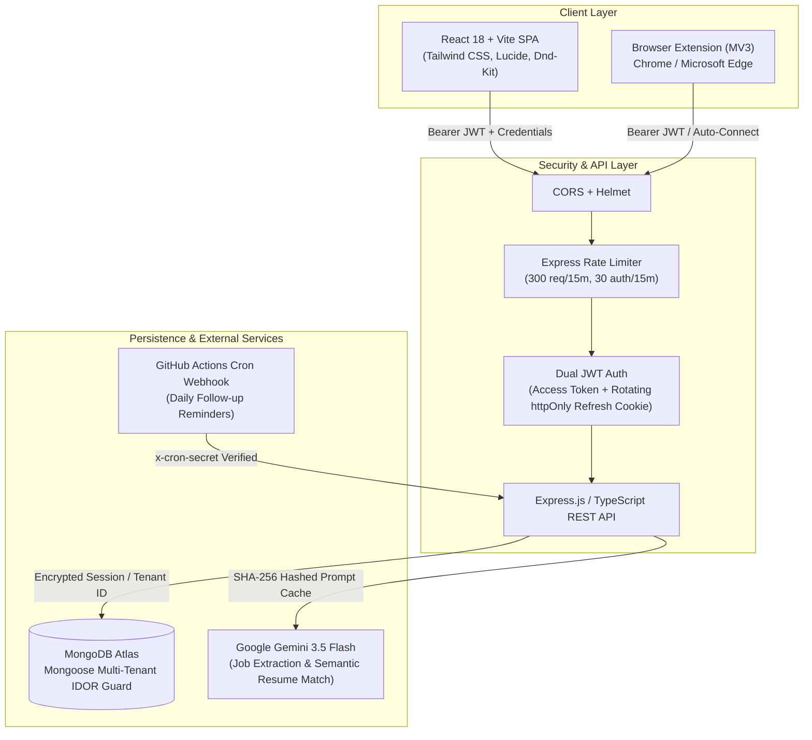

# 🎯 HireTrack AI

> **Intelligent Full-Stack Job Search Management & Real-Time AI Resume Match Engine**  
> Built with React 18, TypeScript, Node.js, Express, MongoDB, Google Gemini AI, and a Manifest V3 Browser Extension.

[](https://github.com/your-username/hiretrack-ai/actions/workflows/ci.yml)
[](https://www.typescriptlang.org/)
[](https://react.dev/)
[](https://nodejs.org/)
[](https://www.mongodb.com/)
[](https://ai.google.dev/)
[](https://opensource.org/licenses/MIT)

---

## ⚡ Live Demo & Quick Access

- **Live Application:** [https://hiretrack.vercel.app](https://hiretrack.vercel.app) *(or your deployed URL)*
- **Recruiter 1-Click Access:** Open the login page and click **"⚡ Explore as Demo Reviewer"** to instantly enter the live Kanban pipeline with pre-populated applications, status histories, and resume match analyses—no registration required!

---

## 🏗️ System Architecture



---

## 🌟 Key Technical Highlights

### 1. 4-Layer Cascade Browser Clipper (Chrome & Edge)
- **Layer 1 (Schema.org JSON-LD):** Instantly parses structured `JobPosting` metadata from standard enterprise career pages.
- **Layer 2 (Platform Adapters):** Dedicated DOM extraction modules for **Indeed (SmartApply 2-pane view)**, **LinkedIn**, **Naukri**, **Glassdoor**, **Wellfound**, and enterprise ATS systems (**Greenhouse, Lever, Ashby, Workday**).
- **Layer 3 (URL De-referencing):** Resolves transient tracker URLs (e.g. `smartapply.indeed.com?jk=...`) into canonical, permanent job URLs.
- **Layer 4 (Semantic Readability + Gemini Fallback):** Intelligently strips navigational noise and uses Google Gemini to extract role, company, salary, and requirements from unstructured career portals with automated token auto-healing on 401.

### 2. Semantic Resume-to-Job Matching Engine
- **Deterministic SHA-256 Cache:** Computes `computeInputHash(resumeText, jdText)` before querying the Gemini API. Identical comparisons return in **<15ms** from MongoDB, drastically reducing LLM inference costs and latency.
- **Actionable Gap Analysis:** Returns an objective 0–100 match score, key matching competencies, critical missing requirements, and tailored interview preparation guidance.

### 3. Production Security & IDOR Prevention
- **Strict Multi-Tenant Isolation:** All database reads, updates, moves, and deletions enforce `{ _id: req.params.id, userId: req.user.userId }` at the Mongoose query level, preventing Insecure Direct Object References (IDOR).
- **Dual-Token JWT Rotation:** Employs rotating refresh tokens stored in `httpOnly`, `SameSite: Lax/None`, `Secure` cookies with SHA-256 hash validation in the database to detect and mitigate token theft.
- **Protection Against Dev Secret Leaks:** In production mode, the server enforces non-default, high-entropy secrets and rejects default fallback keys on startup.
- **Rate Limiting:** Protects `/api/auth/*` against credential stuffing and prevents API quota exhaustion.

### 4. Kanban Pipeline & Real-Time Transitions
- Drag-and-drop state transitions across 6 statuses: `Wishlist` &rarr; `Applied` &rarr; `OA / Test` &rarr; `Interview` &rarr; `Offer` &rarr; `Rejected`.
- Automatic transition history logging (`statusHistory: [{ status, at }]`) for auditability and funnel conversion analytics.

### 5. Automated Follow-Up Reminder Engine
- Includes a scheduled GitHub Actions cron workflow (`.github/workflows/reminders.yml`) that triggers daily at 09:00 AM IST.
- Validates a cryptographically strong `x-cron-secret` before aggregating jobs requiring follow-up action.

---

## 📁 Repository Structure

```text
hiretrack-ai/
├── .github/
│   └── workflows/
│       ├── ci.yml                 # Automated test & build pipeline (Ubuntu + Node 20 + MongoDB)
│       └── reminders.yml          # Daily automated follow-up reminder cron
├── backend/
│   ├── src/
│   │   ├── middleware/            # Auth guard, rate limiter, IDOR validation
│   │   ├── models/                # Mongoose schemas (User, Application, Resume, MatchResult)
│   │   ├── routes/                # REST endpoints (auth, applications, resumes, analytics, internal)
│   │   ├── services/              # Gemini Matcher (with SHA256 cache) & Job Extractor
│   │   └── utils/                 # JWT sign/verify, cookie helpers, crypto hashing
│   ├── tests/                     # Jest & Supertest integration suite (30+ assertions)
│   ├── Dockerfile                 # Multi-stage production container build
│   └── package.json
├── frontend/
│   ├── src/
│   │   ├── api/                   # Axios client with automatic 401 JWT refresh queue
│   │   ├── components/            # Kanban Board, JobCard, JobDrawer, Analytics, Navbar
│   │   ├── context/               # AuthContext, ThemeContext
│   │   └── pages/                 # Dashboard, Board, Resumes, Analytics, Login, Register
│   ├── vercel.json                # SPA rewrite rules for production deployments
│   └── package.json
├── extension/
│   ├── manifest.json              # Chrome / Edge Manifest V3 configuration
│   ├── popup.html / popup.js      # 1-Click Clipper UI with auto-connect & session recovery
│   └── content.js                 # 4-Layer Cascade DOM extraction engine
├── docker-compose.yml             # Local MongoDB + Backend container setup
└── README.md
```

---

## 🚀 Getting Started Locally

### Prerequisites
- [Node.js](https://nodejs.org/) v18+ (v20 recommended)
- [MongoDB](https://www.mongodb.com/) running locally or a [MongoDB Atlas](https://www.mongodb.com/atlas) connection URI
- Google Gemini API Key ([Get one for free at Google AI Studio](https://aistudio.google.com/))

### 1. Clone & Install Dependencies
```bash
git clone https://github.com/your-username/hiretrack-ai.git
cd hiretrack-ai

# Install backend dependencies
cd backend && npm install

# Install frontend dependencies
cd ../frontend && npm install
```

### 2. Configure Environment Variables

**Backend (`backend/.env`):**
```env
PORT=5000
NODE_ENV=development
MONGO_URI=mongodb://127.0.0.1:27017/hiretrack
CLIENT_URL=http://localhost:5173
JWT_ACCESS_SECRET=your_jwt_access_secret_12345
JWT_REFRESH_SECRET=your_jwt_refresh_secret_67890
CRON_SECRET=your_cron_secret_12345
GEMINI_API_KEY=your_actual_gemini_api_key
GEMINI_MODEL=gemini-3.5-flash
```

**Frontend (`frontend/.env`):**
```env
VITE_API_URL=http://localhost:5000
```

### 3. Run the Development Servers

```bash
# Terminal 1 - Start Backend API
cd backend
npm run dev

# Terminal 2 - Start Frontend (Vite)
cd frontend
npm run dev
```

Open [http://localhost:5173](http://localhost:5173) in your browser.

### 4. Load the Browser Extension (Edge / Chrome)
1. Open `edge://extensions` or `chrome://extensions`.
2. Toggle on **Developer mode** in the top-right / left sidebar.
3. Click **Load unpacked** and select the `hiretrack-ai/extension` folder.
4. Open any job listing on Indeed, LinkedIn, or a company career site and click the HireTrack icon!

---

## 🧪 Testing

The backend includes a comprehensive integration test suite built with **Jest**, **Supertest**, and **mongodb-memory-server**:

```bash
cd backend
npm test
```

### Test Coverage Highlights:
- **`auth.test.ts`**: User registration, password hashing verification, JWT rotation, cookie attributes, demo reviewer login.
- **`applications.test.ts`**: Application creation, Kanban state transitions, status histories, cross-user IDOR isolation prevention.
- **`extractor.test.ts`**: Cascade heuristic parsing and Layer 4 Gemini structured extraction.
- **`matcher.test.ts`**: Resume scoring, input hash validation, sub-second cache verification.
- **`analytics.test.ts`**: Funnel metrics aggregation, active interview counters, cron secret authentication.

---

## 📄 License

Distributed under the MIT License. See `LICENSE` for more information.

---

## 👤 Author

Developed by **Gagandeep Singh**  
- GitHub: [@your-github](https://github.com/)  
- LinkedIn: [linkedin.com/in/your-profile](https://linkedin.com/)  
- Portfolio: [your-portfolio.dev](https://your-portfolio.dev)
